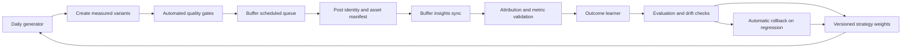

# Aimagix self-improving content engine

## Goal

Automatically make each content batch more useful than the last by learning from the performance of published posts. Keep publishing through Buffer. The learner may adjust content strategy, prompt weights, and creative structure; it must never rewrite application code or change security and publishing controls by itself.

## What already exists

- The Daily Content Intelligence workflow generates, scores, renders, and queues content in Buffer.
- The Sync Instagram Engagement workflow runs every six hours. `AutoLearner` matches mature Instagram posts to generated prompts, refreshes engagement records, and counts each post only once for learning.
- `BayesianUpdater` records an append-only learning ledger, maintains per-business topic, format, audience, and hook weights, and supports replay and rollback.
- `ViralityGate` uses real performance history and learned weights to rank future ideas. The daily pipeline also tries an exploratory variant with a 25% probability.
- Process Feedback accepts explicit post links and feedback through GitHub issues.
- `evaluation.py` reports hit rate, score separation, and sample-size caveats.

This is a useful start, but the loop is mostly a good/bad label derived from scraped posts. It does not yet learn from Buffer’s per-post views, reach, watch time, saves, shares, or follows. Content attribution can also depend on caption similarity unless a post was explicitly linked.

## Target loop

## Learning data contract

Write one durable record for each generated creative, then enrich it as it moves through the pipeline. Use stable `creative_id`, `business_key`, `prompt_id`, Buffer `post_id`, media URL, and workflow run ID as join keys. Never match a post to a creative using text similarity if an exact post ID is available.

Store:

- **Creative features:** format, hook pattern, topic, audience segment, CTA type, script word count, narration duration, beat count, overlay style, caption length, and posting time.
- **Delivery state:** queued, published, failed, or cancelled; scheduled and actual publish timestamps; Buffer post ID; duplicate and quality-gate outcomes.
- **Performance snapshots:** elapsed hours after publication, views, reach, reactions, comments, saves, shares, profile visits, follows, and watch-time fields when Buffer supplies them. Keep missing values as `null`, never as zero.
- **Provenance:** data source, fetched timestamp, API/schema version, and whether each metric is exact, estimated, or unavailable.

Use append-only JSONL events, following `learning_ledger.jsonl`, with a compact current-state summary for fast reads. This lets a workflow rebuild state and makes every weight change explainable.

## Outcome and experiment policy

1. Take performance snapshots at roughly 24 hours, 72 hours, and 7 days. Judge a post only after the 72-hour window; refresh the 7-day snapshot without counting it as another independent trial.
2. Compare posts against the account’s own recent baseline for the same format and age window. Use rates such as saves/reach, shares/reach, follows/reach, and watch time per view where fields exist. Do not compare raw totals across posts with very different reach.
3. Use a blended objective with business-set weights. A reasonable initial objective is reach and view-through for discovery, saves and shares for useful content, and profile visits/follows for conversion. Keep the component metrics visible so a high score cannot hide a collapse in one objective.
4. Update Bayesian estimates with confidence intervals and a hierarchical prior: account history first, then a conservative cross-account prior. Do not promote a factor on one lucky post. Keep minimum sample counts, cap each update’s influence, and decay old evidence slowly.
5. Each daily batch should exploit proven patterns most of the time and explore one controlled variation when queue capacity allows. Change one major feature per experiment (for example, hook style or Reel length), tag it, and compare it with a matched baseline. Randomize across eligible time slots where practical.
6. Automatically raise or lower topic, hook, audience, CTA, format, and duration weights only when the evidence threshold is met. Leave weights unchanged when the signal is sparse, missing, or poorly attributed.

## Buffer-first metrics flow

Add a read-only Buffer insights adapter beside `buffer_publisher.py` and `buffer_state.py`. Buffer currently documents experimental per-post metrics queries that require a personal API key with `insightsRead` access; Buffer warns these metrics may change and are refreshed daily. Use them as an explicitly experimental source, not as authoritative reporting. If Buffer does not expose a metric for a post, retain `null`; do not add Meta API access or browser-based Instagram automation.

The publish step should persist the mapping from creative ID to Buffer post ID immediately after Buffer accepts the post. The six-hour engagement workflow can then fetch metrics by exact ID, upsert snapshots idempotently, and avoid double counting. For already published Instagram posts with no Buffer ID, keep the existing scraper matcher as a lower-confidence fallback and mark the attribution source.

## Automatic improvement boundaries

The system may autonomously:

- Adjust bounded strategy weights, content mix, experiment allocation, and prompt instructions.
- Regenerate a creative that fails hook, script, voice, media, claim, duplicate, or duration checks.
- Skip Buffer queueing when media or attribution checks fail, when the queue is full, or when evidence is insufficient to make a requested optimization.
- Revert the last strategy update when quality or performance alarms trigger.

It must not autonomously:

- Edit Python code, GitHub workflow permissions, repository secrets, account credentials, brand facts, or Buffer settings.
- Invent business proof, offers, or performance claims.
- Treat a failed metric fetch as zero performance.
- Publish a Reel that fails the existing spoken-hook, narration, and duration safeguards.

## Workflows and operations

- **Daily Content Intelligence:** generate a tagged exploration/control batch using current strategy weights, render through quality gates, and queue only eligible creatives through Buffer.
- **Sync Instagram Engagement (six-hourly):** reconcile Buffer post IDs and fetch available snapshots; use Instagram scraping only as a clearly labeled fallback.
- **Weekly Deep Dive:** calculate per-format and per-feature performance, confidence, cohort balance, drift, and proposed weight changes; apply only changes that clear evidence thresholds.
- **Drift Check:** detect missing metrics, broken attribution, stale data, sharp quality regressions, and a persistently falling outcome score. Freeze learning on bad inputs and roll back the last strategy version if a regression is confirmed.

Each run should write a GitHub Actions summary with: posts measured, metrics unavailable, exact-ID attribution rate, matured sample count, current experiment, weight changes with old/new values and evidence, guardrails triggered, and rollback status. The normal path requires no human intervention; exceptions should fail closed and notify through the existing workflow alert.

## Delivery sequence

1. Add the creative-to-Buffer-post identity record and idempotent schema, preserving old logs.
2. Implement a read-only Buffer metrics adapter and fixture-based tests for missing fields, retries, pagination, and duplicate snapshots.
3. Add 24-hour/72-hour/7-day cohort evaluation and confidence-aware outcome scores.
4. Connect the evaluated scores to bounded Bayesian updates and report every change in the ledger and Actions summary.
5. Add controlled feature experiments and a regression rollback rule; start in report-only mode, then enable autonomous weight changes after attribution is verified.

## Success criteria

- At least 95% of Buffer-scheduled posts are joined to the correct creative by exact IDs.
- Repeated workflow runs do not duplicate snapshots or learning trials.
- Missing analytics never become zero-valued outcomes.
- Every automated strategy change can be replayed, explained, and rolled back.
- On a rolling 8-week window with at least 20 matured posts, the optimized cohort improves the account’s chosen rate-based objective over the matched baseline without bypassing any media or truthfulness gate.

Until Buffer post-level insights are wired into the workflow, the existing learner can keep using its current Instagram engagement path, but it should be described as a limited feedback loop rather than full Reel-performance optimization.
